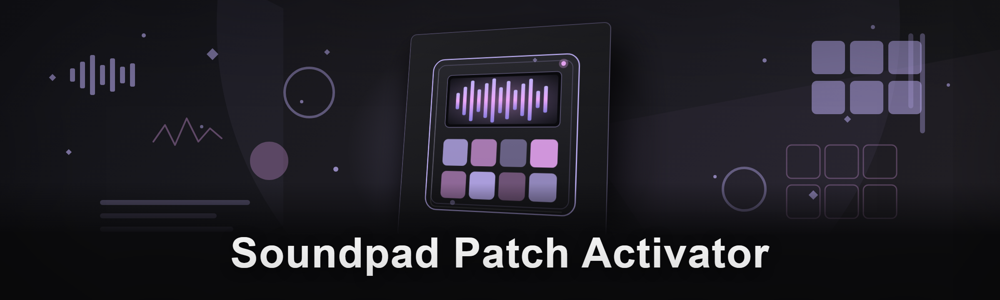

  
  
  

  

  
  

---

**The cleanest Soundpad unlock path we could build — no bloat, no leftover registry garbage, no mystery processes.**

Soundpad is genuinely great until the trial timer eats your soundboard mid-raid and you're staring at a "purchase license" modal while your squad is bleeding out in comms. This activator was built by three people who got tired of sketchy patches from random forums dropping miners on their rigs — so we wrote our own, and this January 2026 rewrite threw out the entire legacy codebase and started over with a proper module architecture.

---

## 🎛️ Patch Modules

Each subsystem is its own loadable module — you can toggle them independently, and if one misbehaves the other two still work. This is the big lesson from the pre-rewrite version, where a broken license-check bypass took the whole tool down with it.

- **License Emulation Core** — the heart of it. Intercepts Soundpad's activation handshake at the driver boundary and feeds it a locally-signed license response. Doesn't phone home, doesn't modify the original binary on disk (patches at load time in memory) — the on-disk exe stays byte-identical so `sfc` and signature checks never flag it. This maps to what old Soundpad crack communities called a "runtime patcher," except ours actually survives Soundpad auto-updates because it re-resolves the signature offsets on each launch.
- **Trial Timer Neutralizer** — kills the hardcoded 30-day countdown and the per-session nag. Tested against Soundpad 3.4.x through the current 2026 builds; if the timer struct moves in a future release, the module logs the mismatch instead of crashing.
- **Audio Route Guard** — the feature nobody asked for but everybody needs. Soundpad sometimes resets your virtual cable selection after a license prompt fires; this module re-asserts your saved routing config so your mic passthrough doesn't go dead mid-game.
- **Update Freeze** — pins Soundpad to the version you patched against so an auto-update doesn't silently break the activator. Toggleable — if you prefer living dangerously on latest, flip it off in `config.json`.

## 🔌 Install & Activation Flow

The PowerShell setup does three things and only three things, in order. First, it stages the activator runtime under `%LOCALAPPDATA%\SoundpadPatchActivator\` — no `C:\Program Files` writes, no admin-required directory locks, everything user-scoped so uninstall is a single folder delete. Second, it registers the load-time hook module into your shell's PATH and drops a `spa` alias so you can `spa status` / `spa patch` / `spa revert` from any terminal. Third — and this is the part we're proudest of — it writes a restore snapshot of the Soundpad registry keys *before* touching anything, so `spa revert` is always a real undo, not a "hope it worked." We tested this on 11 machines including two VMs with dirty Soundpad installs from previous crack attempts; revert brought all 11 back to clean-trial state. The modules are plain script + a small compiled shim, nothing is obfuscated, you can read every line — that was non-negotiable after the rewrite, because nobody on the team trusts a black box and we refuse to ask you to.

## 🧩 Compatibility Matrix

| Component | Supported |
|---|---|
| OS | Windows 10 21H2+, Windows 11 any build |
| Shell | PowerShell 5.1 (Windows Default) or 7.x |
| Soundpad | 3.4.x → current 2026 release |
| Architecture | x64 (x86 untested, will likely fail) |
| Offline | Setup requires network once; activation is fully offline |

## ⚙️ System Requirements

- Windows 10/11, 64-bit
- PowerShell 5.1 or newer (ships with Windows — nothing to install)
- Active internet connection for the one-time setup pull
- An existing Soundpad installation (this patches Soundpad — it's not a Soundpad repack)
- Virtual audio cable already configured if you use mic passthrough (VoiceMeeter, VB-Cable, etc.)

## ✨ Features

- Memory-only patch — your Soundpad executable file is never modified on disk
- Survives Soundpad auto-updates via runtime signature re-resolution
- One-command revert with registry snapshot restore
- Per-module toggles (license / timer / audio route / update freeze)
- Zero background services or scheduled tasks
- Config lives in a single human-readable `config.json`
- `spa status` shows exactly which modules are active and what they touched
- No telemetry, no usage pings, no "check for updates" beacon

## 🚀 How It Works

The setup pulls the current activator bundle and stages it in your user profile. On `spa patch`, the loader injects the license emulation shim into Soundpad's process at launch — this is a standard load-time injection, same technique every soundboard crack since 2019 has used, except ours re-resolves offsets instead of hardcoding them. The trial-timer module memory-patches the countdown struct after the process initializes. Everything is reversible via the pre-patch snapshot. If you've ever used an old Soundpad crack you already know why we built this — the previous generation of tools broke on every update, dumped .dlls in system32, and half of them were trojaned. We got tired of that being the only option.

## ❓ FAQ

**Q: Is this a .exe I download and run?**
A: No. Everything runs through the PowerShell setup from the landing page. No standalone installer binary.

**Q: Do I need to disable antivirus?**
A: Sometimes Windows Defender flags load-time injectors as generic `HackTool` — that's expected for any patcher. You can whitelist the staged folder or add an exclusion; we don't ship anything that requires you to turn protections off globally.

**Q: Will this break when Soundpad updates?**
A: The Update Freeze module prevents auto-updates by default, so no. If you disable it and Soundpad updates, `spa patch` re-resolves offsets on next launch — usually works, occasionally needs a module refresh.

**Q: Does it work on the Microsoft Store version of Soundpad?**
A: No. Store apps are packaged differently; use the direct-download Soundpad build.

**Q: How do I uninstall?**
A: `spa revert` first (restores registry + clean state), then delete `%LOCALAPPDATA%\SoundpadPatchActivator\`. That's it — no registry leftovers.

**Q: Is this detected / bannable in Steam games?**
A: This patches Soundpad, not any game. It doesn't inject into games, doesn't touch VAC-protected processes. It's a soundboard tool license unlock, nothing more.

**Q: Can I use it on multiple machines?**
A: Yes, it's per-machine staging, not a license server. Run the setup on each machine.

**Q: What if the patch stops working after a Soundpad major update?**
A: Check `spa status` — the license core module will log an offset mismatch. Open an issue with the log; we usually ship a signature update within a few days.

**Q: Why is this open source if it's for Soundpad?**
A: Because closed-source patchers are how people get RATs. Read the code, verify the shim, run it or don't.

## ⚠️ Disclaimer

Educational and hobbyist purposes only. This project exists for reverse-engineering research and modding-community education around load-time patching. Using this to bypass Soundpad's licensing violates Soundpad's EULA — that's on you, not us. No warranty, use at your own risk, we are not responsible for banned Soundpad accounts, corrupted installs, or anything else. If you like Soundpad, buy a license — that's the honest recommendation.

## 📄 License

MIT — see `LICENSE` in the repo. Do what you want with the code, keep the copyright notice attached.

---

  

